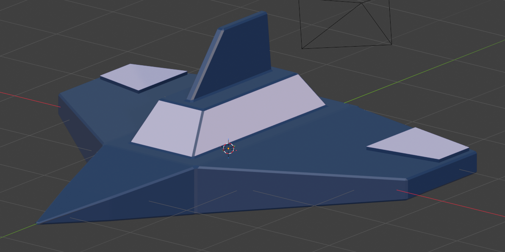
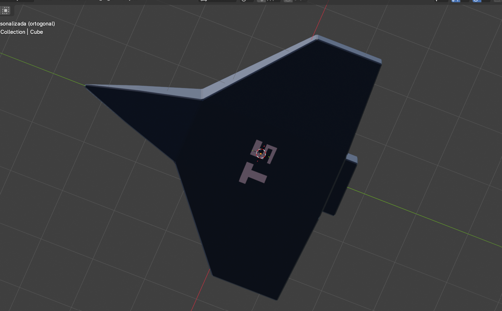

# Lab 3: Modelo 3D

Nave espacial inspirada en la estética de *Midnights*, con un cuerpo azul medianoche y detalles lavanda. El modelo se construyó a partir de un solo cubo, modificando la misma malla sin agregar otras figuras.

## Imágenes del modelo

### Vista 1

### Vista 2

## Características

- Cuerpo central con punta estrecha.
- Dos alas laterales con paneles elevados.
- Cabina con caras lavanda y una aleta superior.
- Propulsor trasero con un marco y el centro hundido.
- Bordes biselados.
- Letras **TS** trazadas en la parte inferior de la nave mediante cortes en la malla.
- Materiales de color base simple, sin texturas ni materiales complejos.

## Herramientas utilizadas

| Herramienta | Uso |
| --- | --- |
| Move | Desplazar los extremos de las alas y ajustar el propulsor. |
| Scale | Dar proporción al cuerpo y estrechar la punta, la cabina y la aleta. |
| Extrude | Construir la punta, las alas, la cabina, la aleta, el propulsor y los paneles. |
| Inset | Crear bordes en la cabina, el propulsor y los paneles. |
| Bevel | Biselar ligeramente los bordes. |
| Subdivide | Dividir las superficies de las alas para crear los paneles. |
| Knife | Trazar las letras TS directamente sobre la superficie inferior. |

## Archivos

| Archivo | Contenido |
| --- | --- |
| `Nave.blend` | Proyecto editable en Blender. |
| `Nave.obj` | Modelo exportado para la entrega. |
| `Nave.mtl` | Materiales asociados al OBJ. |
| `nave-vista-1.png` | Primera captura del modelo. |
| `nave-vista-2.png` | Segunda captura del modelo. |
| `README.md` | Descripción del laboratorio. |

## Abrir el modelo

Para editarlo, abrir `Nave.blend` en Blender.

Para inspeccionar la exportación, usar **Archivo → Importar → Wavefront (.obj)** y seleccionar `Nave.obj`. Mantener `Nave.mtl` en la misma carpeta para que puedan cargarse los colores.

## Exportación

Desde el proyecto final, seleccionar la nave en Modo Objeto y usar **Archivo → Exportar → Wavefront (.obj)**. Activar **Sólo lo seleccionado**, **Normales**, **Malla triangulada** y **Materiales**. Guardar el resultado como `Nave.obj`, acompañado de `Nave.mtl`.

